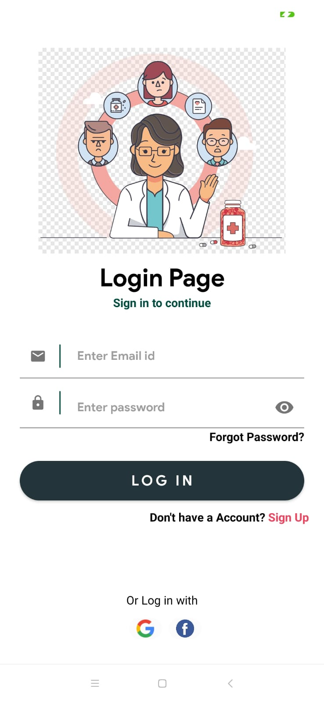
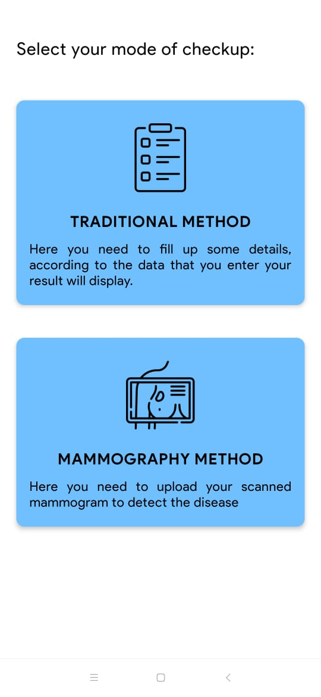
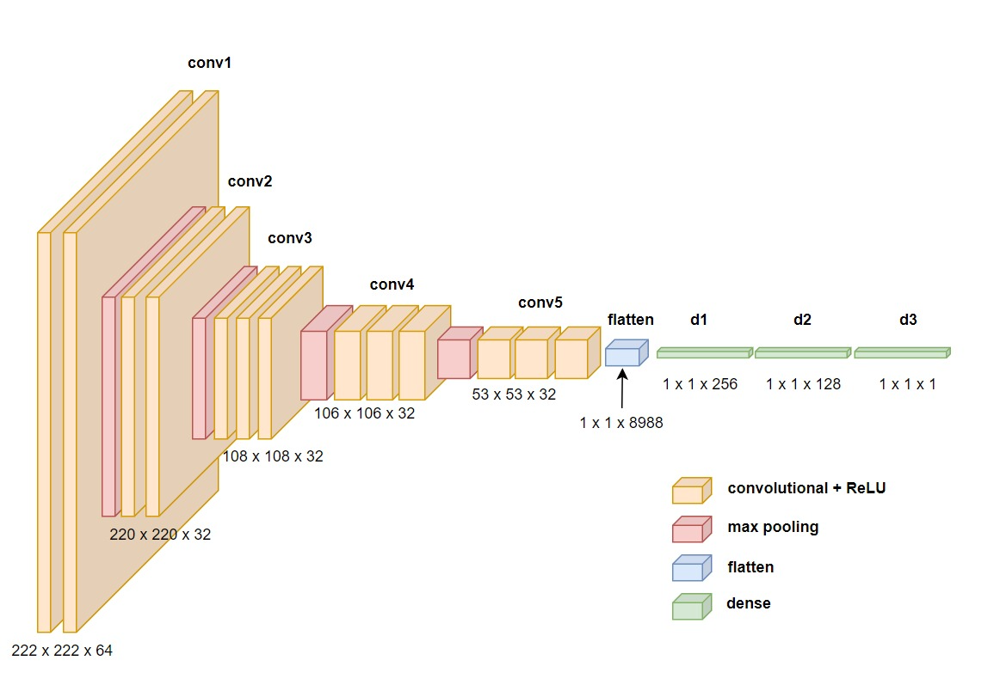

# Multiple Disease Detection App

An Android-based health support application that brings together
image-based disease detection, symptom-based disease prediction, basic
health calculators, and nearby healthcare assistance in one place.

> **Important medical disclaimer:** This project is for educational and
> informational purposes only. Its predictions are not a medical
> diagnosis and must not replace advice from a qualified healthcare
> professional. Always consult a clinician for medical concerns.

## Table of Contents

-   [Overview](#overview)
-   [Features](#features)
-   [Screenshots](#screenshots)
-   [Machine Learning](#machine-learning)
-   [Technology](#technology)
-   [Getting Started](#getting-started)
-   [Repository Structure](#repository-structure)
-   [Limitations](#limitations)
-   [Future Improvements](#future-improvements)

## Overview

The Multiple Disease Detection App aims to make selected health-related
tools accessible through a single mobile application. Users can create
an account or sign in, explore disease detection options, use health
calculators, enter symptoms for a possible disease prediction, and find
nearby hospitals or emergency contacts.

## Features

### 1. Account and authentication

-   Login and registration screens.
-   Forgot-password flow.
-   Firebase Authentication for account access.

### 2. Image-based disease detection

The app provides dedicated options for selected disease-detection
workflows, including: - Brain tumour detection. - Breast cancer
detection. - COVID-19 detection. - Skin cancer detection. - Heart-attack
risk prediction.

The available input method depends on the selected workflow. For
example, the breast cancer flow includes a mammography-image option as
well as a traditional input method.

### 3. Health calculators

-   Body Mass Index (BMI) calculator.
-   Daily water-intake calculator.

These tools provide general informational estimates and are not
substitutes for individual medical advice.

### 4. Symptom-based disease prediction

-   Users enter selected symptoms.
-   A Decision Tree model is used to produce a possible disease
    prediction based on the entered information.
-   Results should be treated as an initial informational guide only.

### 5. Healthcare assistance

-   Nearby hospital locator.
-   Emergency-contact functionality.
-   Health consultation section with additional healthcare-related
    options.

## Screenshots

### Account screens

  -----------------------------------------------------------------------
  Login                               Register
  ----------------------------------- -----------------------------------
     

  -----------------------------------------------------------------------


### Main application

  ---------------------------------------------------------------------------------
  Disease detection                            Healthcare assistance
  -------------------------------------------- ------------------------------------
     screen](assets/health-consult.png)

  ---------------------------------------------------------------------------------

### Disease prediction workflow



Example result screens:

  --------------------------------------------------------------------------------------------------
  Example: benign result                          Example: malignant result
  ----------------------------------------------- --------------------------------------------------
     result](assets/prediction-malignant-example.png)

  --------------------------------------------------------------------------------------------------

*These screenshots illustrate the app's interface and example model
outputs. They do not establish clinical accuracy or suitability for
real-world diagnosis.*

### Model architecture



## Machine Learning

The project includes deep-learning-based image classification and a
Decision Tree approach for symptom-based prediction.

-   **Convolutional Neural Network (CNN):** Used in the
    image-classification component.
-   **Decision Tree:** Used for symptom-based disease prediction.
-   **Model outputs:** Intended to provide educational predictions from
    the model's inputs.

Performance depends on the training data, preprocessing, model
evaluation, and input quality. Do not use the app to make treatment
decisions.

## Technology

Based on the project implementation, the app uses or includes the
following technologies:

-   **Android:** Mobile application interface.
-   **Java/Kotlin:** Android application development.
-   **Firebase Authentication:** User registration and login.
-   **TensorFlow / Keras:** CNN-based deep-learning workflow.
-   **Decision Tree:** Symptom-based prediction.
-   **Google Maps / location services:** Nearby hospital discovery,
    where configured.

## Getting Started

1.  Clone or download this repository:

    ``` bash
    git clone https://github.com/yash123-vis/MultipleDiseaseDetectionApp.git
    ```

2.  Open the project in Android Studio.

3.  Allow Gradle to sync and install any dependencies required by the
    project.

4.  Configure Firebase for your own project and add the appropriate
    `google-services.json` file if required by the app's current setup.

5.  Review any model files, datasets, API keys, permissions, and
    location settings required by the implementation.

6.  Build and run the app on an Android emulator or compatible device.

**Note:** Exact SDK versions, model files, and configuration steps
depend on the current repository contents. Check the project files and
Gradle configuration before building. Do not commit private credentials,
production API keys, or sensitive Firebase configuration.

## Repository Structure

The screenshots used in this README are stored in the `assets/`
directory:

``` text
MultipleDiseaseDetectionApp/
├── README.md
└── assets/
    ├── login.png
    ├── register.png
    ├── forgot-password.png
    ├── disease-detection-home.png
    ├── health-consult.png
    ├── checkup-methods.png
    ├── prediction-benign-example.png
    ├── prediction-malignant-example.png
    ├── cnn-architecture.png
    └── project-cover.png
```

The application source-code structure may differ from this simplified
documentation layout.

## Limitations

-   Predictions are model-generated estimates, not confirmed diagnoses.
-   Results depend on the quality and representativeness of the data
    used to train and evaluate each model.
-   Nearby hospital and emergency features may require location
    permission, network access, and valid service configuration.
-   The app should not be used to delay emergency care or professional
    medical evaluation.

## Future Improvements

-   Add model evaluation details, datasets, and reproducible training
    instructions.
-   Improve input validation, accessibility, and error handling.
-   Add clear explanations of model confidence and known limitations.
-   Expand testing across devices and input conditions.
-   Validate healthcare-related features with qualified domain experts
    before any real-world clinical use.

## Author

**Yash Bhagia**

-   GitHub: [@yash123-vis](https://github.com/yash123-vis)
-   Project repository:
    [MultipleDiseaseDetectionApp](https://github.com/yash123-vis/MultipleDiseaseDetectionApp)
